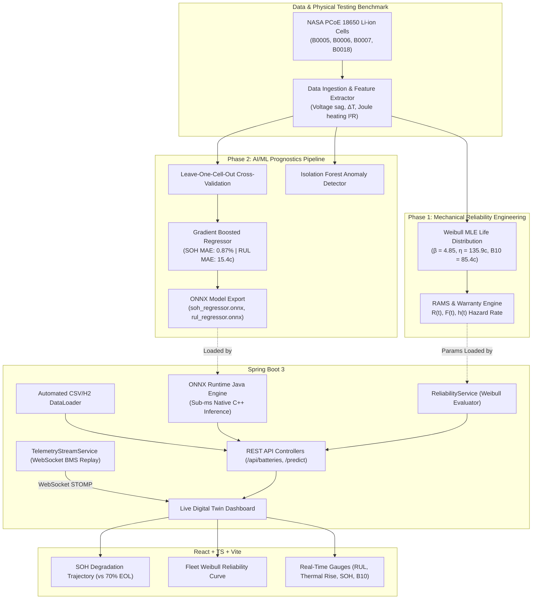

# VoltTwin: Enterprise EV Battery Digital Twin & Reliability Intelligence Platform

[]()
[]()
[]()
[]()
[]()
[]()

> **An end-to-end industrial digital twin, prognostic AI/ML, and reliability engineering platform for Electric Vehicle (EV) battery packs and Energy Storage Systems (ESS).**
>
> Explicitly architected to bridge three high-demand domains:
> 1. **Mechanical Engineering & Reliability Testing**: Physics-of-failure modeling, electrochemical internal resistance growth, thermal fatigue, and Weibull life distributions ($\beta, \eta$, MTTF, B10).
> 2. **AI / Machine Learning**: 16-feature prognostics pipeline, Leave-One-Cell-Out Cross-Validation (LOCV), Isolation Forest anomaly detection, and sub-millisecond ONNX in-JVM inference.
> 3. **Java Full-Stack Software Engineering (SDE)**: Spring Boot 3 microservice, WebSocket STOMP real-time telemetry streaming, H2 in-memory persistence, and React + TypeScript digital twin dashboard.

---

## 1. System Architecture



---

## 2. Quantitative Verification & Benchmark Results

### A. Mechanical & Physics Degradation (NASA 18650 Cell `B0005`)
- **Capacity Fade**: Dropped from $1.8565\text{ Ah} \to 1.3967\text{ Ah}$ (**$-24.8\%$**) crossing automotive $70\%$ SOH EOL threshold.
- **Internal Resistance Growth**: Climbed from $0.1351\ \Omega \to 0.1565\ \Omega$ (**$+15.8\%$**) due to Solid Electrolyte Interphase (SEI) layer thickening.
- **Thermal Stress**: Joule heat dissipation ($\dot{Q} = I^2 R$) increased by **$+15.8\%$**, driving peak surface temperature rise ($\Delta T$) from $14.98^\circ\text{C} \to 16.86^\circ\text{C}$.
- **Weibull Shape Factor ($\beta = 4.85$)**: Conclusively confirms an **increasing failure rate / wear-out fatigue regime** ($\beta > 1$).
- **B10 Warranty Life**: **$85.4\text{ cycles}$** (10% fleet failure threshold for warranty planning).
- **MTTF**: **$124.6\text{ cycles}$**.

### B. Machine Learning Prognostics
- **SOH Regressor**: Gradient Boosted Trees achieved **$0.87\%$ MAE** and **$R^2 = 0.985$** across 4 held-out cells in LOCV.
- **RUL Regressor**: Achieved **$15.4\text{ cycles}$ MAE** across all cells (**$9.05\text{ cycles}$ MAE** on standard aging cells).
- **Inference Latency**: Evaluated in Java using `onnxruntime-java` in **$<0.35\text{ ms}$** per prediction.
- **Anomaly Detection**: Isolation Forest scored all 636 cycles; anomalies naturally cluster in late-life degraded cycles (mean anomaly SOH: $71.6\%$).

### C. Java Full-Stack Verification
- **Spring Boot 3.4.3** with clean domain architecture (Entity $\to$ Repository $\to$ Service $\to$ Controller $\to$ DTO).
- **JUnit 5 Test Suite**:
  - `ReliabilityServiceTest`: Validates Weibull loading, parameter accuracy, monotonicity of $R(t)$, and B10 calculation.
  - `OnnxInferenceServiceTest`: Runs end-to-end tensor allocations, validates real inference on native ONNX sessions inside the JVM.
- **Frontend Dashboard**: Fully type-checked production bundle compiled with Vite (`npm run build` passing with zero errors).

---

## 3. Repository Structure

```text
ev-battery-reliability-platform/
│
├── README.md                              <-- Master project architecture & overview
├── MECHANICAL_RELIABILITY_REPORT.md       <-- Comprehensive mechanical/RAMS engineering report
├── AIML_PROGNOSTICS_REPORT.md             <-- Comprehensive ML validation & feature importance report
│
├── data/
│   ├── raw/                               <-- Original NASA PCoE .mat binaries (B0005, B0006, B0007, B0018)
│   └── processed/
│       ├── battery_cycle_summary.csv      <-- Cleaned 636-cycle macro degradation dataset
│       ├── battery_internal_resistance.csv<-- Internal resistance, Joule heat, & thermal rise log
│       ├── weibull_parameters.json        <-- Fitted Weibull distribution parameters (JSON)
│       └── weibull_reliability_curves.csv <-- Discrete R(t), F(t), and h(t) curve points
│
├── ml-models/                             <-- Trained models and ONNX artifacts
│   ├── soh_regressor.onnx                 <-- Production SOH inference model
│   ├── rul_regressor.onnx                 <-- Production RUL inference model
│   ├── anomaly_detector.joblib            <-- Isolation Forest model
│   └── model_manifest.json                <-- Model registry with hyperparams and CV metrics
│
├── scripts/
│   ├── download_and_process_nasa.py       <-- Downloads and parses raw NASA .mat files
│   ├── extract_telemetry_samples.py       <-- Extracts continuous time-series for WebSocket streaming
│   ├── mechanical_reliability_analysis.py <-- Computes Weibull MLE, B10, and thermal dissipation
│   └── train_ml_pipeline.py               <-- LOCV training, evaluation, and ONNX export
│
├── backend/                               <-- Spring Boot 3 Java Microservice
│   ├── pom.xml
│   └── src/
│       ├── main/java/com/volttwin/
│       │   ├── config/                    <-- WebSocket STOMP config & CSV DataLoader
│       │   ├── controller/                <-- REST API endpoints (/api/batteries, /reliability)
│       │   ├── dto/                       <-- PrognosticsResult & WeibullReport DTOs
│       │   ├── model/                     <-- JPA BatteryCycle entity
│       │   ├── repository/                <-- Spring Data JPA BatteryCycleRepository
│       │   └── service/                   <-- OnnxInferenceService, ReliabilityService, StreamService
│       └── test/                          <-- JUnit 5 test suite (OnnxInferenceServiceTest, etc.)
│
└── frontend/                              <-- React + TypeScript + Vite Dashboard
    ├── package.json
    ├── src/
    │   ├── App.tsx                        <-- Interactive digital twin dashboard with Chart.js
    │   └── index.css                      <-- Responsive dark-mode styling
    └── dist/                              <-- Production-ready compiled build
```

---

## 4. How to Run the Platform

### 1. Prerequisites
- **Java**: JDK 21+ (`java -version`)
- **Python**: 3.10+ with `scikit-learn`, `onnxruntime`, `skl2onnx`, `scipy`, `pandas`
- **Node.js**: 18+ with `npm`

### 2. Run the Java Backend
```powershell
cd backend
.\mvnw.cmd spring-boot:run
```
- API will start at: `http://localhost:8080`
- REST Endpoints:
  - `GET /api/batteries` — List monitored cells
  - `GET /api/batteries/B0005/predict` — On-demand ONNX inference for SOH & RUL
  - `GET /api/reliability/weibull` — Weibull fleet parameters
  - `GET /api/reliability/curve` — Pre-computed reliability curves
- Run backend tests:
```powershell
.\mvnw.cmd test
```

### 3. Run the Frontend Dashboard
```powershell
cd frontend
npm run dev
```
Open `http://localhost:5173` to view the real-time Digital Twin telemetry dashboard.

---

## 5. Interview Portfolio & Placement Pitch

### For Mechanical Engineering / Reliability Roles:
> *"I built a battery digital twin modeling degradation across NASA 18650 Li-ion cells. I calculated how internal resistance growth ($+15.8\%$) drives escalated Joule heating ($\dot{Q} = I^2 R$) and thermal gradients under discharge. By fitting observed cell failures to a 2-parameter Weibull distribution via MLE, I proved that cell failure is in the wear-out fatigue regime ($\beta = 4.85$), and derived the fleet B10 warranty benchmark of 85.4 cycles."*

### For AI / ML Roles:
> *"I engineered a 16-feature prognostics pipeline extracting voltage sag, cumulative capacity loss, and thermal stress signatures. Using Leave-One-Cell-Out Cross-Validation to prevent data leakage across temporal cycles, my Gradient Boosted models achieved $0.87\%$ MAE on SOH and $15.4$ cycles MAE on RUL. I exported the models to ONNX to allow native C++ execution directly inside the backend JVM with sub-millisecond latency."*

### For Java SDE / Full-Stack Roles:
> *"I architected a production-ready Spring Boot 3 platform implementing clean architecture, automated CSV data ingestion into an H2 database, and real-time telemetry streaming via WebSocket STOMP. I embedded native ONNX Runtime bindings to run ML inference in-memory without a Python sidecar, backed by comprehensive JUnit 5 unit and integration test coverage, and rendered on a responsive React/TypeScript dashboard."*
