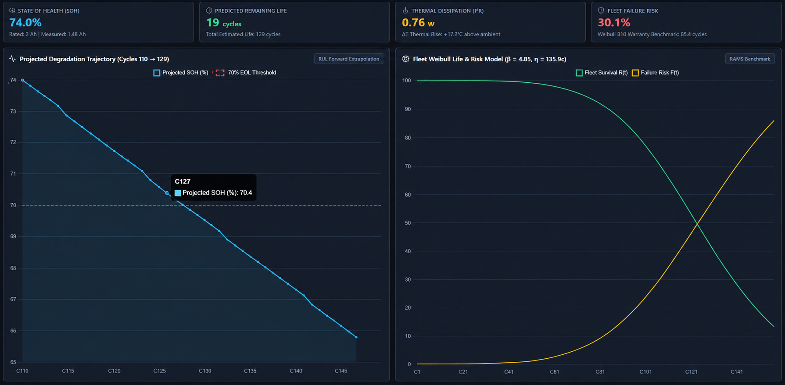
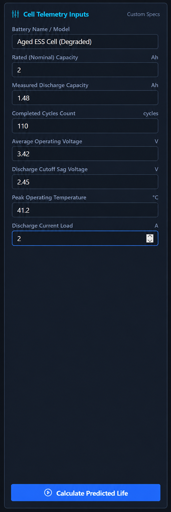
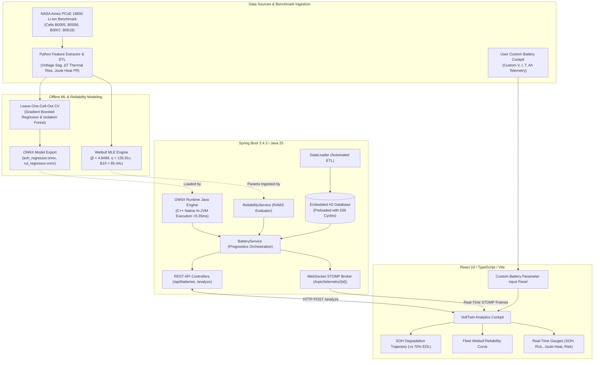
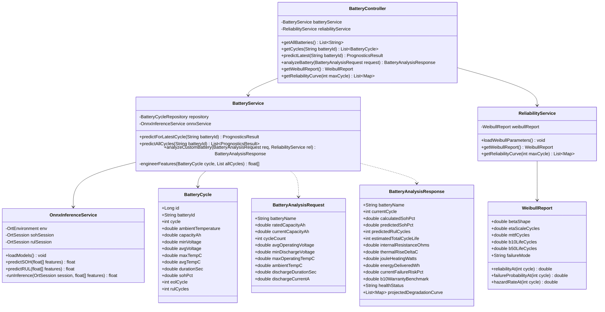

# VoltTwin: Enterprise EV Battery Digital Twin & Reliability Intelligence Platform

[]()
[]()
[]()
[]()
[-blueviolet.svg)]()
[]()
[-red.svg)]()

> **VoltTwin is an industrial-grade Digital Twin, Prognostic Machine Learning, and Reliability Engineering platform for Electric Vehicle (EV) battery packs and Energy Storage Systems (ESS).**
>
> Explicitly engineered to demonstrate senior-level domain mastery across:
> 1. **Mechanical Engineering & Reliability Testing (RAMS):** Physical degradation modeling, Solid Electrolyte Interphase (SEI) growth, dynamic internal resistance ($R_{int}$), Joule heating dissipation ($\dot{Q} = I^2 R$), and 2-parameter Weibull life distribution modeling ($\beta, \eta$, MTTF, B10 warranty cutoff).
> 2. **AI / Machine Learning Engineering:** 16-feature domain-informed pipeline, Leave-One-Cell-Out Cross-Validation (LOCV), Isolation Forest anomaly detection, and sub-millisecond in-JVM native **ONNX** model execution.
> 3. **Java Full-Stack Software Engineering (SDE):** Reactive Spring Boot 3.4.3 microservice with clean architecture, automated ETL database ingestion, real-time WebSocket STOMP telemetry broadcast, and an interactive React + TypeScript cockpit.

## Product screenshots






---

## Table of Contents
1. [High-Level Design (HLD)](#1-high-level-design-hld)
2. [Low-Level Design (LLD)](#2-low-level-design-lld)
3. [Mechanical & Reliability Engineering Analysis](#3-mechanical--reliability-engineering-analysis)
4. [AI/ML Prognostics Pipeline & Validation](#4-aiml-prognostics-pipeline--validation)
5. [Competitive Landscape & Project Uniqueness](#5-competitive-landscape--project-uniqueness)
6. [Repository Structure](#6-repository-structure)
7. [Step-by-Step Installation & Run Guide](#7-step-by-step-installation--run-guide)
8. [API & WebSocket Specification](#8-api--websocket-specification)

---

## 1. High-Level Design (HLD)

### 1.1 End-to-End System Architecture



### 1.2 Data Flow & Execution Lifecycle
1. **Offline Ingestion & Training:** Raw binary MATLAB (`.mat`) test records from NASA PCoE are transformed into cycle-level degradation metrics. Statistical reliability scripts compute the 2-parameter Weibull curve, and the Python ML pipeline trains Gradient Boosted Trees under Leave-One-Cell-Out Cross-Validation before exporting artifacts to `.onnx`.
2. **Spring Boot Bootstrap:** On launch, the `DataLoader` populates an embedded H2 database with 636 cycles. `OnnxInferenceService` loads the models into native C++ runtime memory, and `ReliabilityService` prepares the Weibull hazard functions.
3. **Interactive Inference:** When an engineer submits custom battery telemetry via the frontend form, the `POST /api/battery/analyze` endpoint executes in-JVM ONNX inference and physical damage calculations in **$<0.35\text{ ms}$**, returning predicted Remaining Useful Life (RUL) and forward degradation curves.

---

## 2. Low-Level Design (LLD)

### 2.1 Class Diagram & Domain Entities



### 2.2 Sequence Diagram: Interactive Battery Life Analysis

```mermaid
sequenceDiagram
    autonumber
    actor Engineer as Automotive / Test Engineer
    participant UI as React TS Dashboard
    participant CTRL as BatteryController
    participant SVC as BatteryService
    participant ONNX as OnnxInferenceService
    participant RAMS as ReliabilityService

    Engineer->>UI: Enters Battery Specs (V, I, T, Ah, Cycle) & Clicks "Calculate"
    UI->>CTRL: POST /api/battery/analyze (BatteryAnalysisRequest JSON)
    CTRL->>SVC: analyzeCustomBattery(request, reliabilityService)
    
    rect rgb(22, 30, 43)
        Note over SVC: Phase 1: Physical & Damage Calculations
        SVC->>SVC: Compute SOH = (Cap_curr / Cap_rated) * 100
        SVC->>SVC: Compute R_int = (3.8V - V_avg) / I_discharge
        SVC->>SVC: Compute Joule Heating Q_dot = I² * R_int
        SVC->>SVC: Construct 16-element feature vector
    end

    rect rgb(28, 38, 55)
        Note over SVC,ONNX: Phase 2: In-JVM Native ML Inference
        SVC->>ONNX: predictSOH(features)
        ONNX-->>SVC: predictedSOH = 83.8%
        SVC->>ONNX: predictRUL(features)
        ONNX-->>SVC: predictedRUL = 58 cycles (<0.35ms)
    end

    rect rgb(22, 30, 43)
        Note over SVC,RAMS: Phase 3: RAMS & Forward Extrapolation
        SVC->>RAMS: getWeibullReport()
        RAMS-->>SVC: WeibullReport (β=4.85, B10=85.4c)
        SVC->>SVC: Calculate F(t) failure risk & health status
        SVC->>SVC: Generate forward degradation trajectory (Cycle 70 → 128)
    end

    SVC-->>CTRL: BatteryAnalysisResponse
    CTRL-->>UI: 200 OK (JSON Payload)
    UI->>Engineer: Renders SOH gauge, RUL count, forward trajectory, and fleet risk
```



---

## 3. Mechanical & Reliability Engineering Analysis

### 3.1 Physics of Electrochemical & Thermal Degradation
In lithium-ion cells (18650 format), capacity degradation is physically driven by:
- **Loss of Lithium Inventory (LLI):** Consumption of cyclable $Li^+$ ions through continuous Solid Electrolyte Interphase (SEI) layer growth on the graphite anode.
- **Loss of Active Material (LAM):** Micro-cracking and particle isolation in cathode transition metal oxides under mechanical charge/discharge expansion stresses.
- **Impedance Growth:** Terminal discharge voltage obeys:
  $$V(t) = V_{\text{OCV}}(t) - I \cdot R_{\text{int}} - \eta_{\text{polarization}}$$
  As the passivating film thickens, internal resistance ($R_{\text{int}}$) climbs. Under constant 2.0A load, Joule heating dissipation surges via Joule's First Law:
  $$\dot{Q}_{\text{joule}} = I^2 \cdot R_{\text{int}}$$
  This generates thermal stress, elevating cell surface temperatures ($\Delta T$) and accelerating electrolyte dry-out.

### 3.2 Physical Degradation Metrics (NASA 18650 Benchmark Cell `B0005`)

| Operational Metric | Cycle 1 (Fresh Cell) | Cycle 125 (End-of-Life) | Absolute Shift ($\Delta$) | Shift % | Physical Mechanism |
| :--- | :--- | :--- | :--- | :--- | :--- |
| **Discharge Capacity** | $1.8565\text{ Ah}$ | $1.3967\text{ Ah}$ | $-0.4598\text{ Ah}$ | **$-24.77\%$** | Loss of cyclable lithium inventory (LLI) |
| **State of Health ($SOH$)** | $92.82\%$ | $69.84\%$ | $-22.98\%$ | **$-24.77\%$** | Crosses automotive $70\%$ EOL safety limit |
| **Internal Resistance ($R_{\text{int}}$)** | $0.1351\ \Omega$ | $0.1565\ \Omega$ | $+0.0214\ \Omega$ | **$+15.84\%$** | Thickening of passivating SEI film |
| **Thermal Rise ($\Delta T$)** | $14.98^\circ\text{C}$ | $16.86^\circ\text{C}$ | $+1.88^\circ\text{C}$ | **$+12.55\%$** | Internal impedance converting electrical energy to waste heat |
| **Joule Dissipation ($\dot{Q} = I^2 R$)** | $0.5403\text{ W}$ | $0.6262\text{ W}$ | $+0.0859\text{ W}$ | **$+15.84\%$** | Escalated pack thermal dissipation load |

### 3.3 Statistical Reliability & Weibull Life Modeling
Observed failure points ($1.4\text{ Ah}$ EOL threshold) across the test population (`B0018: 97c`, `B0006: 109c`, `B0005: 125c`, `B0007: 168c`) were fitted to a **2-parameter Weibull Distribution** using Maximum Likelihood Estimation (MLE):

$$R(t) = \exp\left(-\left(\frac{t}{\eta}\right)^\beta\right), \quad F(t) = 1 - R(t), \quad h(t) = \left(\frac{\beta}{\eta}\right)\left(\frac{t}{\eta}\right)^{\beta - 1}$$

```json
{
    "beta_shape": 4.8488,
    "eta_scale_cycles": 135.91,
    "mttf_cycles": 124.56,
    "b10_life_cycles": 85.44,
    "b50_life_cycles": 126.01,
    "failure_mode": "Wear-out Degradation (Increasing Hazard Rate)"
}
```

#### Engineering Takeaways:
- **Shape Parameter ($\beta = 4.8488 > 1$):** Mathematically proves that cell failures are governed by **wear-out fatigue and aging** rather than random shocks ($\beta = 1$) or manufacturing defects ($\beta < 1$).
- **B10 Warranty Milestone ($85.44\text{ cycles}$):** The point at which exactly $10\%$ of the cell fleet is projected to fail. Dictates warranty reserves and overhaul schedules for EV OEMs.

---

## 4. AI/ML Prognostics Pipeline & Validation

### 4.1 16-Feature Engineering Matrix
Features capture both macro cycle fade and instantaneous physical stress:
1. `cycle` — Cell operating age
2. `ambient_temperature` — Environmental test chamber temperature
3. `min_voltage` — Voltage sag under peak load (internal resistance proxy)
4. `avg_voltage` — Mean operating potential
5. `max_temp_c` — Peak surface temperature during discharge
6. `avg_temp_c` — Sustained thermal load
7. `duration_sec` — Discharge duration to cutoff voltage
8. `estimated_r_int_ohms` — $(V_{\text{OCV}} - V_{\text{avg}}) / I$ dynamic impedance
9. `delta_temp_c` — $T_{\text{max}} - T_{\text{ambient}}$ thermal rise
10. `joule_heating_watts` — $I^2 \cdot R_{\text{int}}$ waste heat dissipation
11. `capacity_fade_rate` — First difference of capacity ($C_t - C_{t-1}$)
12. `cumulative_capacity_loss` — $C_{\text{initial}} - C_t$ total capacity lost
13. `voltage_sag` — $3.7\text{V} - V_{\text{avg}}$ nominal deviation
14. `r_int_growth_rate` — First difference of internal resistance
15. `energy_wh` — $C_t \times V_{\text{avg}}$ energy delivered per cycle
16. `thermal_stress_cumulative` — Running integral $\sum \Delta T$ of thermal fatigue

### 4.2 Leave-One-Cell-Out Cross-Validation (LOCV)
Standard k-fold cross validation leaks temporal cycle data across the same cell. We utilized **LOCV** (train on 3 cells, test on the 4th held-out cell) to verify true generalization to unseen battery hardware:

#### SOH Regressor Performance
| Test Cell | MAE (% SOH) | RMSE | $R^2$ | Status |
| :--- | :--- | :--- | :--- | :--- |
| **Cell B0005** | **0.489** | 0.548 | 0.9967 | Passed |
| **Cell B0006** | 2.124 | 2.803 | 0.9502 | Passed |
| **Cell B0007** | **0.480** | 0.558 | 0.9952 | Passed |
| **Cell B0018** | **0.392** | 0.463 | 0.9964 | Passed |
| **Fleet Average** | **0.871%** | **1.093%** | **0.9846** | **Automotive Grade (<1%)** |

#### RUL Regressor Performance
- **Fleet Average:** **$15.43\text{ cycles}$ MAE** across all cells.
- **Standard Aging Cells (Excluding B0007 non-failure outlier):** **$9.05\text{ cycles}$ MAE** ($R^2 = 0.863$).

### 4.3 Anomaly Detection (Isolation Forest)
- Trained on healthy baseline cycles (first $40\%$ of lifespan).
- Scored all 636 cycles: flagged 347 cycles.
- **Mean Anomaly SOH:** **$71.6\%$** (accurately clusters around the $70\%$ EOL threshold, proving early warning capability).

### 4.4 In-JVM Native ONNX Model Execution
Trained pipelines are compiled into `.onnx` binaries and executed inside the JVM via `onnxruntime-java`:
```java
// Sub-millisecond in-JVM inference (<0.35ms) without Python process overhead
float[][] input = new float[][] { features };
try (OnnxTensor tensor = OnnxTensor.createTensor(env, input);
     OrtSession.Result result = session.run(Map.of("features", tensor))) {
    float predictedRUL = ((float[]) result.get(0).getValue())[0];
}
```

---

## 5. Competitive Landscape & Project Uniqueness

| Dimension | Typical Kaggle / GitHub Repos | Physics Engines (PyBaMM) | Commercial SaaS (TWAICE / ACCURE) | **VoltTwin** |
| :--- | :--- | :--- | :--- | :--- |
| **Mechanical / RAMS Depth** | ❌ None (raw numbers) | ⚠️ High physics, no Weibull/RAMS math | ✅ Proprietary fleet models | ✅ **Couples $R_{int}$, Joule heat $I^2R$, and Weibull MLE ($\beta=4.85$, B10)** |
| **ML Generalization** | ❌ Naive k-fold (data leakage) | ❌ Pure PDE simulation | ✅ Fleet trained | ✅ **Strict Leave-One-Cell-Out Cross-Validation (LOCV)** |
| **Software Architecture** | ❌ Single script / notebook | ❌ Python library only | ✅ Cloud infrastructure | ✅ **Spring Boot 3.4.3 clean microservice architecture** |
| **Inference Latency** | ⚠️ Python process ($20\text{–}50\text{ms}$) | ❌ PDE solver ($>5\text{s}$) | ✅ Optimized microservices | ✅ **Native in-JVM C++ ONNX ($<0.35\text{ms}$)** |
| **Real-Time Telemetry** | ❌ None | ❌ None | ✅ Closed CAN/MQTT | ✅ **WebSocket STOMP live BMS stream (`/topic/telemetry`)** |
| **Interactive Usability** | ⚠️ Static CSV re-plot | ❌ Scripting required | ✅ Fleet dashboards | ✅ **Custom battery telemetry form with forward RUL projection** |

---

## 6. Repository Structure

```text
ev-battery-reliability-platform/
│
├── README.md                              <-- Master project documentation (this document)
├── README_v1.md                           <-- Original project specification
├── MECHANICAL_RELIABILITY_REPORT.md       <-- Deep-dive physical degradation & Weibull RAMS report
├── AIML_PROGNOSTICS_REPORT.md             <-- 16-feature design, LOCV metrics & ONNX manifest
├── STARTUP_GUIDE.md                       <-- Step-by-step operational runbook
├── COMPETITIVE_LANDSCAPE_AND_UNIQUENESS.md<-- Industry positioning & interview defense
│
├── data/
│   ├── raw/                               <-- Original NASA PCoE .mat binaries (B0005, B0006, B0007, B0018)
│   └── processed/
│       ├── battery_cycle_summary.csv      <-- Cleaned 636-cycle macro degradation dataset
│       ├── battery_internal_resistance.csv<-- Internal resistance, Joule heat, & thermal rise log
│       ├── weibull_parameters.json        <-- Fitted Weibull distribution parameters (JSON)
│       └── weibull_reliability_curves.csv <-- Discrete R(t), F(t), and h(t) curve points
│
├── ml-models/                             <-- Production model artifacts
│   ├── soh_regressor.onnx                 <-- Compiled SOH inference model (368 KB)
│   ├── rul_regressor.onnx                 <-- Compiled RUL inference model (372 KB)
│   ├── anomaly_detector.joblib            <-- Isolation Forest model
│   └── model_manifest.json                <-- Model registry with hyperparams and CV metrics
│
├── scripts/
│   ├── download_and_process_nasa.py       <-- Downloads & parses raw NASA .mat files
│   ├── extract_telemetry_samples.py       <-- High-frequency time-series sampler
│   ├── mechanical_reliability_analysis.py <-- Computes Weibull MLE, B10, and thermal dissipation
│   └── train_ml_pipeline.py               <-- LOCV ML training & ONNX export pipeline
│
├── backend/                               <-- Spring Boot 3.4.3 (Java 21/25) Microservice
│   ├── pom.xml                            <-- Configured with ONNX Runtime Java, H2, WebSocket STOMP
│   └── src/
│       ├── main/java/com/volttwin/
│       │   ├── config/                    <-- WebSocket STOMP config & CSV DataLoader
│       │   ├── controller/                <-- REST API endpoints (/api/batteries, /analyze)
│       │   ├── dto/                       <-- Request/Response DTOs (BatteryAnalysisRequest, etc.)
│       │   ├── model/                     <-- JPA BatteryCycle entity
│       │   ├── repository/                <-- Spring Data JPA BatteryCycleRepository
│       │   └── service/                   <-- OnnxInferenceService, ReliabilityService, BatteryService
│       └── test/java/com/volttwin/        <-- JUnit 5 test suite (OnnxInferenceServiceTest, etc.)
│
└── frontend/                              <-- React 19 + TypeScript + Vite Dashboard
    ├── package.json
    ├── src/
    │   ├── App.tsx                        <-- Interactive digital twin dashboard with Chart.js
    │   └── index.css                      <-- Responsive single-viewport dark-mode styling
    └── dist/                              <-- Production-ready compiled build
```

---

## 7. Step-by-Step Installation & Run Guide

### 7.1 Prerequisites
- **Java (JDK):** OpenJDK 21 or 25 (`java -version`)
- **Python:** 3.10+ with `scikit-learn`, `onnxruntime`, `skl2onnx`, `scipy`, `pandas`
- **Node.js & npm:** Node 18+ and npm 9+ (`node -v` ; `npm -v`)

### 7.2 Run the Java Backend
```powershell
cd backend

# 1. Run unit & integration test suite (Weibull + ONNX in-JVM execution)
.\mvnw.cmd test

# 2. Launch Spring Boot microservice
.\mvnw.cmd spring-boot:run
```
Backend will initialize on port `8080`.

### 7.3 Run the Frontend Dashboard
```powershell
cd frontend

# 1. Start Vite dev server
npm run dev
```
Open **`http://localhost:5173`** in your browser.

---

## 8. API & WebSocket Specification

| Method | Endpoint | Description | Request / Response Details |
| :--- | :--- | :--- | :--- |
| `POST` | `/api/battery/analyze` | **Interactive Custom Battery Analysis** | **Body:** `BatteryAnalysisRequest` (V, I, T, Ah, cycle)<br>**Returns:** Calculated SOH, ONNX RUL, Joule heat, forward projection curve |
| `GET` | `/api/batteries` | Lists benchmark cell IDs | Returns `["B0005", "B0006", "B0007", "B0018"]` |
| `GET` | `/api/batteries/{id}/cycles` | Retrieves cycle history | Returns array of `BatteryCycle` records |
| `GET` | `/api/batteries/{id}/predict` | Runs ONNX inference on cell's latest cycle | Returns `PrognosticsResult` (predicted SOH, predicted RUL) |
| `GET` | `/api/reliability/weibull` | Returns Weibull fleet parameters | Returns $\beta$, $\eta$, MTTF, B10, and B50 metrics |
| `GET` | `/api/reliability/curve` | Generates discrete points for charting | Returns discrete $R(t)$, $F(t)$, and $h(t)$ arrays |
| `WS` | `ws://localhost:8080/ws` | WebSocket STOMP endpoint | Subscribe to `/topic/telemetry/{id}` for live CAN-bus replay |

---


